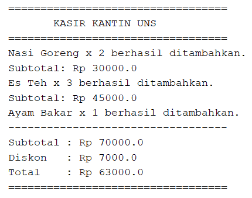
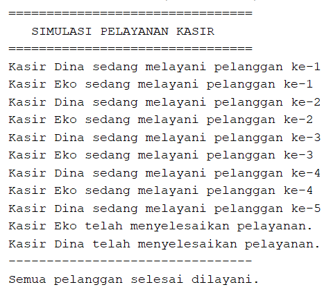
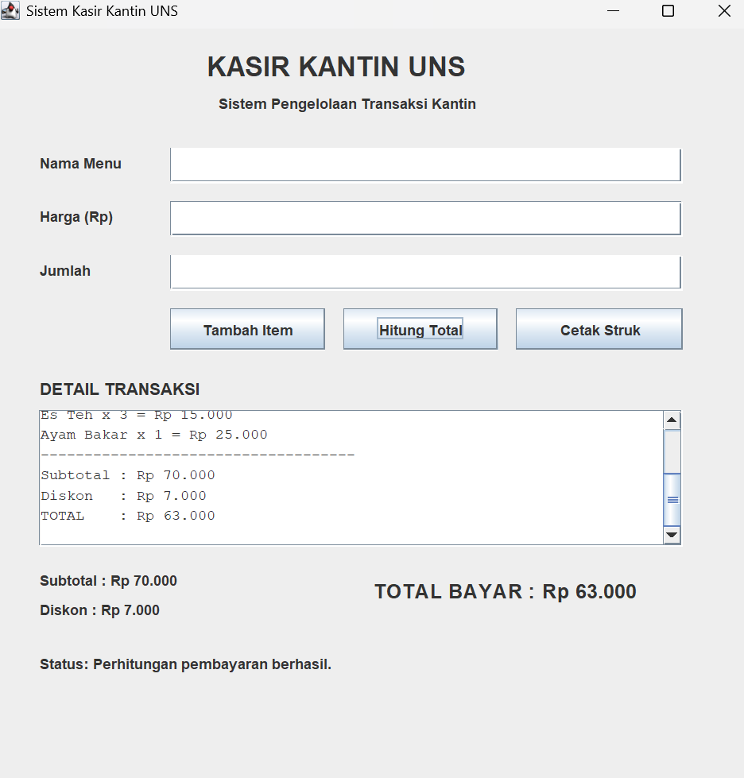
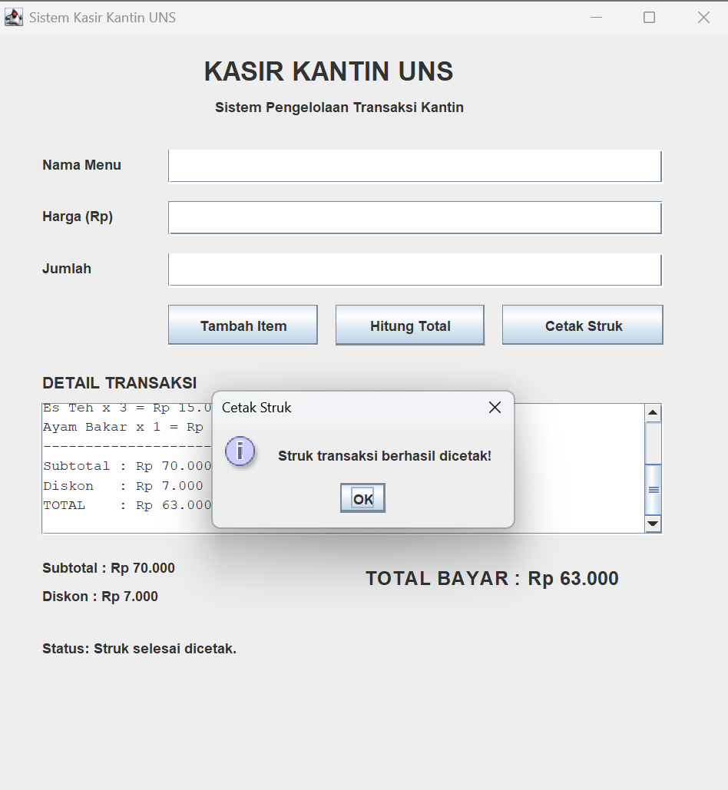

# Lab Session 03 PBO
Nama  : Indah Rahmadianti
NIM   : L0325029
Kelas : B Informatika PSDKU
Matkul: Pemrograman Berorientasi Objek

## 1. Deskripsi Program

Sistem Kasir Kantin UNS merupakan aplikasi sederhana berbasis Java yang
dibuat untuk menerapkan materi Praktikum PBO Pertemuan 11 dan 12.
Program menggabungkan pengelolaan transaksi menggunakan konsep
pemrograman berorientasi objek, simulasi pelayanan dua kasir menggunakan
multithreading, serta antarmuka pengguna menggunakan Java Swing.

Aplikasi memungkinkan pengguna memasukkan nama menu, harga, dan jumlah
barang. Sistem kemudian menghitung subtotal, diskon, dan total
pembayaran. Selain itu, tersedia simulasi dua kasir yang melayani
pelanggan secara bersamaan serta fitur simulasi pencetakan struk tanpa
membuat jendela aplikasi macet.

## 2. Struktur Class

  `Pesanan.java`                      Mengelola data transaksi,
                                      menghitung subtotal, diskon 10%
                                      jika subtotal lebih dari Rp50.000,
                                      total pembayaran, dan mengatur
                                      ulang subtotal.

  `Kasir.java`                        Merepresentasikan kasir sebagai
                                      thread. Setiap objek kasir
                                      menjalankan pelayanan pelanggan
                                      melalui method `run()`.

  `KasirFrame.java`                   Membuat tampilan aplikasi
                                      menggunakan Java Swing, mengelola
                                      input, menampilkan daftar pesanan,
                                      menghitung pembayaran, dan
                                      menjalankan simulasi cetak struk.

  `MainKasir.java`                    Menjadi titik awal program. Class
                                      ini menguji logika transaksi,
                                      menjalankan dua thread kasir, lalu
                                      membuka aplikasi GUI.

## 3. Penjelasan tiap tahap

### Tahap 1 -- Class Logika

Class `Pesanan` memiliki atribut `subtotal` dengan akses `private` untuk
menerapkan enkapsulasi. Method `tambahItem(harga, jumlah)` menambahkan
hasil perkalian harga dan jumlah ke subtotal. Method `getSubtotal()`
digunakan untuk membaca subtotal, `hitungTotal()` menghitung total
setelah diskon, dan `reset()` mengembalikan subtotal menjadi nol.
Program juga menambahkan `getDiskon()` agar nilai potongan dapat
ditampilkan secara terpisah pada struk.

Pada tahap ini terdapat pembuatan class pesanan, atribut private, method penambahan item, 
pembacaan subtotal, perhitungan diskon, dan reset.

### Tahap 2 -- Dua Kasir sebagai Thread

Class `Kasir` menggunakan `extends Thread`, sehingga setiap objek kasir
dapat dijalankan sebagai thread tersendiri. Method `run()` berisi
perulangan pelayanan pelanggan dan `Thread.sleep(400)` untuk memberi
jeda pada setiap pelayanan. Di `MainKasir`, objek Dina dan Eko
dijalankan menggunakan `start()`. Method `join()` digunakan agar program
utama menunggu kedua kasir selesai.

### Tahap 3 -- Tampilan GUI Kasir

Class `KasirFrame` membangun jendela aplikasi menggunakan Java Swing.
Komponen `JLabel` digunakan untuk keterangan, `JTextField` untuk input
nama menu, harga, dan jumlah, `JButton` untuk menjalankan perintah,
serta `JTextArea` di dalam `JScrollPane` untuk menampilkan rincian
transaksi.

Tombol **Tambah Item** membaca data dari form, memvalidasi input,
menambahkan item ke objek `Pesanan`, dan menampilkan item pada area
struk. Tombol **Hitung Total** menampilkan subtotal, diskon, dan total
pembayaran. Kesalahan input ditangani dengan `try-catch`, sedangkan
pesan informasi atau kesalahan ditampilkan menggunakan `JOptionPane`.

### Tahap 4 -- Cetak Struk dengan Thread

Method `cetakStruk()` membuat thread baru untuk menjalankan simulasi
pencetakan. Status diubah menjadi **Mencetak struk...**, kemudian thread
menunggu selama dua detik menggunakan `Thread.sleep(2000)`. Setelah
selesai, `SwingUtilities.invokeLater()` digunakan untuk memperbarui
label status pada GUI menjadi **Struk selesai dicetak**.

Tahap ini menjalankan proses cetak melalui thread baru menggunakan 
`start()`, menunggu dua detik, dan memperbarui status. 
Karena waktu tunggu dilakukan di thread terpisah, Event Dispatch Thread (EDT)
tidak tertahan oleh proses tersebut sehingga jendela tetap responsif.

## 4. Penjelasan Output Program

### Output Tahap 1 -- Perhitungan Transaksi

*Gambar 1. Hasil perhitungan transaksi: subtotal Rp70.000, diskon Rp7.000, dan total Rp63.000.*

Data pengujian yang digunakan:

  Menu               Harga   Jumlah   Subtotal Item
  ------------- ---------- -------- ---------------
  Nasi Goreng     Rp15.000        2        Rp30.000
  Es Teh           Rp5.000        3        Rp15.000
  Ayam Bakar      Rp25.000        1        Rp25.000
  **Total**                            **Rp70.000**

Dua menu pertama menghasilkan subtotal Rp45.000 sehingga belum
memperoleh diskon. Setelah Ayam Bakar ditambahkan, subtotal menjadi
Rp70.000. Karena subtotal lebih dari Rp50.000, sistem memberikan diskon
10% sebesar Rp7.000. Total pembayaran menjadi **Rp63.000**.

### Output Tahap 2 -- Simulasi Dua Kasir

*Gambar 2. Simulasi Kasir Dina dan Eko yang melayani pelanggan menggunakan dua thread.*

Terminal menampilkan aktivitas Kasir Dina dan Kasir Eko yang melayani
pelanggan. Keduanya berjalan secara bersamaan, sehingga baris keluaran
dapat muncul bergantian dan urutannya tidak harus selalu sama. Setelah
kedua thread selesai, program menampilkan pesan **"Semua pelanggan
selesai dilayani."** sebagai tanda bahwa seluruh pelayanan telah
berakhir.

### Output Tahap 3 -- GUI Kasir

*Gambar 3. Tampilan aplikasi kasir dengan form input, tombol transaksi, detail pesanan, dan ringkasan pembayaran.*

Jendela aplikasi menampilkan form nama menu, harga, dan jumlah, serta
tombol Tambah Item, Hitung Total, dan Cetak Struk. Ketika item berhasil
ditambahkan, nama menu, jumlah, dan nilai item muncul pada area struk.
Setelah tombol Hitung Total ditekan, aplikasi menampilkan subtotal,
diskon, dan total pembayaran. Jika input kosong atau tidak sesuai
format, aplikasi menampilkan pesan peringatan.

Dengan data uji pada Tahap 1, hasil yang ditampilkan adalah subtotal
**Rp70.000**, diskon **Rp7.000**, dan total **Rp63.000**.

### Output Tahap 4 -- Simulasi Cetak Struk

*Gambar 4. Pemberitahuan bahwa simulasi cetak struk berhasil dan status telah selesai.*

Saat tombol Cetak Struk ditekan, label status berubah menjadi
**"Mencetak struk..."**. Setelah jeda dua detik, status berubah menjadi
**"Struk selesai dicetak."** dan aplikasi menampilkan pesan bahwa
simulasi pencetakan berhasil. Selama proses menunggu, pengguna tetap
dapat menggunakan fungsi transaksi lainnya karena proses penundaan
berlangsung pada thread terpisah.

## 5. Kesimpulan

Berdasarkan pengerjaan praktikum, aplikasi Sistem Kasir Kantin UNS telah
menggabungkan konsep pemrograman berorientasi objek, multithreading, dan
GUI Programming. Class `Pesanan` mengelola perhitungan transaksi dengan
menerapkan enkapsulasi. Class `Kasir` menunjukkan penggunaan thread
untuk menjalankan dua proses pelayanan secara bersamaan, sedangkan
`KasirFrame` menyediakan antarmuka agar transaksi dapat dilakukan
melalui jendela aplikasi.

Fitur cetak struk juga menerapkan thread terpisah sehingga proses
menunggu tidak menghambat responsivitas GUI. Hasil pengujian transaksi
menunjukkan subtotal Rp70.000, diskon Rp7.000, dan total pembayaran
Rp63.000. Dengan demikian, program telah mencakup fungsi utama yang
diminta pada keempat tahap praktikum, dengan beberapa pengembangan
berupa validasi input, tampilan rincian diskon, format Rupiah, dan
informasi status transaksi.

